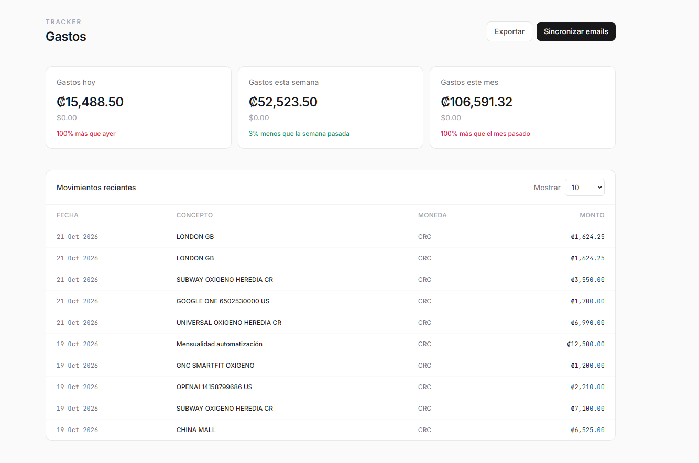

# Tracker de gastos por IMAP

Script local que lee un inbox de Gmail, usa Claude para detectar si un mail es un gasto, y guarda concepto, monto, moneda y fecha en TursoDB.

Si el `message_id` ya existe, lo salta entonces Claude no procesa nunca dos veces el mismo email, ni se guarda un duplicado.

Dashboard local para ver KPIs y movimientos. Sincronizar emails solo corre cuando se toca el botón.



## Setup

```bash
python -m venv env
env\Scripts\activate
pip install -r requirements.txt
cp .env.example .env
```

Llenar `.env` con Turso, Anthropic y el Gmail (app password).

```bash
python db.py
python app.py
```

Abrir `http://127.0.0.1:5000`.

## Proximos pasos

Desplegar el dashboard como web app personal.
